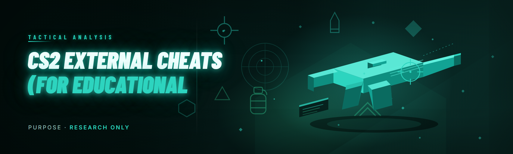

  
  
  

  

  
  
  

---

---

## 🎯 The Pitch

**A fully external CS2 cheat suite that doesn't cost $30/month, doesn't phone home, and doesn't need a driver.**

I built this because every "premium" CS2 external on the market in 2026 is either a subscription-farming piece of malware disguised as a cheat, a DMA card setup that costs more than the GPU, or a 2024-era fork that still crashes on every CS2 update and leaks your HWID to someone's Discord webhook. You already know why. Overwolf overlays that get you VAC-flagged, "undetected" loaders that are detected within 48 hours, ESPs that draw through walls but also draw through smoke and lose you the round, spoofers that brick your NIC. I got tired of paying for it and tired of debugging other people's broken builds.

This repo is the free, source-visible, offline-first alternative. No subscription. No token auth. No webhook exfil. Just a single `.exe`, a config folder, and a memory-read overlay that runs entirely in userland.

### 📦 Grab the build

  

---

## 🧭 Table of Contents

- [What This Actually Is](#-what-this-actually-is)
- [How The Internals Work](#-how-the-internals-actually-work)
- [Comparison — Why Not Just Pay For One](#-comparison--why-not-just-pay-for-one)
- [Key Features](#-key-features)
- [Module Catalog](#-module-catalog)
  - [👁️ Visual ESP Modules](#️-visual-esp-modules)
  - [🎯 Aim Assistance Modules](#-aim-assistance-modules)
  - [🔧 Player & Economy Tweaks](#-player--economy-tweaks)
  - [🎛️ Overlay & Interface Modules](#️-overlay--interface-modules)
  - [🛰️ Recon & Info Modules](#️-recon--info-modules)
- [Usage Guidelines](#-usage-guidelines)
- [Hotkeys](#-hotkeys)
- [Tips For Best Results](#-tips-for-best-results)
- [Known Issues](#-known-issues)
- [Roadmap](#-roadmap)
- [System Requirements](#-system-requirements)
- [The Solution](#-the-solution)
- [FAQ](#-faq)
- [Troubleshooting Flow](#-troubleshooting-flow)

---

## 🧩 What This Actually Is

| Term | Explanation |
|------|-------------|
| **External** | The cheat runs as a separate process from `.exe`. It reads game memory via `ReadProcessMemory` and renders to a transparent topmost window. It never injects a DLL, never hooks the game's functions in-process, and never touches the game's code pages. |
| **ESP** | Extra Sensory Perception — box, skeleton, health, name, weapon, and distance overlays drawn over player models. "Wallhack" if you're old-school. |
| **Overlay** | A borderless, per-pixel-alpha, click-through window layered above the game surface via `WS_EX_LAYERED \| WS_EX_TRANSPARENT`. Nothing is drawn inside the game's render pipeline. |
| **Reader** | The memory-reading component. Signature-scanned offsets resolved against the current `client.dll` / `engine2.dll`. This is the part that breaks on every Valve patch. |
| **Config** | Plain JSON in `./config/`. No encryption, no cloud sync. Edit by hand if you want. |
| **Draw-through** | Whether ESP renders on top of geometry (walls, props) or is depth-occluded. Controlled per-module — you don't want skeleton showing through smoke at match point. |

**Why people actually use external builds like this:**

- No injection vector for anti-cheat to scan for in-process.
- Crash-resistant — if the reader dies, the game keeps running.
- Debuggable. You can attach a debugger to *your own cheat process* without tripping anything.
- Configs are portable and human-readable.
- Single binary, no runtime install.

---

## ⚙️ How The Internals Actually Work

This is the section that paid alternatives don't give you, and it's the part you actually need to understand if you're going to modify this.

The suite boots into three cooperating threads inside one userland process. The first is the **resolver**: on launch it opens a handle to `.exe` with `PROCESS_VM_READ | PROCESS_QUERY_INFORMATION`, walks the module list, locates `client.dll`, and applies a set of byte-pattern signatures to recover the offsets for the local player, the entity list, the view matrix, the radar base, and the bone matrix array. These signatures are the maintenance burden — when Valve restructures `C_CSPlayerPawn` or reorders the entity list freelist, the offsets shift and the signature needs a new wildcard. Everything downstream depends on the resolver succeeding within the first ~200ms of attach, so if you're seeing a black overlay with no boxes, the resolver is what failed, and the debug log will tell you which signature didn't match.

The second thread is the **sampler**. It runs a tight read loop at a configurable interval (default 8ms) pulling entity positions, health, team indices, weapon IDs, and bone matrices into a double-buffered snapshot. The snapshot swap is atomic so the renderer never draws a half-updated frame with an entity position from tick N and a health value from tick N-1 — that mismatch is what causes the famous "dead player still has a box" glitch in cheaper externals. The sampler deliberately reads *slightly more* than any single render pass needs, because ESP and aim-bot both pull from the same snapshot and you don't want to serialize two readers against the same handle.

The third thread is the **presenter**. It owns a layered topmost window sized to the game client rect (tracked via `GetClientRect` on the game's HWND, with `SetWinEventHook` catching move/resize). It renders with GDI+ into an offscreen bitmap, then `UpdateLayeredWindow` paints it in one shot — this is deliberately slower than D3D but keeps the cheat entirely out of the graphics driver path, which matters for detection surface. On top of the presenter sits the **world-to-screen** transform: it pulls the current view matrix, projects each entity origin and each bone origin into clip space, rejects anything behind the near plane, and converts to screen pixels. That projection is the whole ballgame — if boxes drift when you pan the camera, the view matrix read is stale, and the fix is almost always lowering the sampler interval or checking that the resolver picked up the right `dwViewMatrix` offset.

The **aimbot thread** is separate and off by default. It reads from the sampler's snapshot, picks a target using a priority tree (FOV distance × visibility × threat weighting), computes a delta in screen space, and moves the cursor via `SendInput` with `MOUSEEVENTF_MOVE` relative deltas — not `SetCursorPos`, which teleports and is both obvious to spectators and breaks on fullscreen. Smoothing is applied per-axis with a configurable humanization curve, and the whole loop can be gated behind an activation key so it only runs when you're holding the button.

Config, logging, and the hotkey listener all run on a fourth, lighter thread. The `.exe` is a single signed-agnostic build — no installer, no service, no scheduled task.

---

## 🥊 Comparison — Why Not Just Pay For One

| Aspect | Paid External (typical 2026) | This Build |
|--------|------------------------------|------------|
| **Cost** | $25–$45/month subscription, HWID-bound | Free, MIT, no account |
| **Auth** | License key server, phone-home on every launch | None — runs offline |
| **Update model** | Vendor pushes silent updates on their schedule | You patch the signature file yourself, or pull a fork |
| **Config** | Encrypted, cloud-synced, sometimes vendor-locked | Plain JSON in `./config/`, hand-editable |
| **Detection surface** | Loader + injector + driver (needed for their "kernel" features) | Userland overlay only, no driver |
| **Source visibility** | Closed | Fully open, audit the reader yourself |
| **Failure mode** | Voided sub, support ticket, wait 3 days | Signature fails → you see the debug log line and fix it |

Framing is deliberate — the paid ones win on *convenience* (they maintain the offsets for you). This one wins on *transparency* and *cost*, and asks that you understand what a signature is.

---

## 🎁 Key Features

| Feature | Description | Benefit |
|---------|-------------|---------|
| ExtEsp | Box, skeleton, health bar, name, weapon, distance — independently toggled per module | Tune your visual load, don't drown in clutter |
| AimAssist | FOV-limited, humanized smoothing, optional visibility check before lock | Assists without looking like a bot in demos |
| BonePriority | Configurable target bone (head / chest / pelvis) with fallback chain | Consistent hit registration, no pelvis snaps |
| RadarHack | Full-map radar with enemy positions and view angles | You read rotations 5 seconds early |
| NoFlash | Writes flash alpha to zero on the local player only | Land your flick through the flash |
| SniperCrosshair | Crosshair drawn for scoped weapons during scope-in transition | No more scoped-without-crosshair moments |
| BombTimer | C4 plant countdown and defuse timer with callout text | Retake timing without the guess |
| SoundEsp | Directional ring flash when footsteps play within audible radius | Punish pushes through smoke |
| VelocityCheck | True pre-fire from velocity delta on the local player | Legit-looking pre-fires on peek |
| GrenadePrediction | Trajectory arc with bounce markers | Lineups without a workshop server |
| SpectatorList | Lists who's currently spectating you | Know when you're being watched |
| ConfigProfiles | Multiple JSON profiles, hot-swap at runtime | Legit profile vs offline profile, one key |

---

## 🧱 Module Catalog

25 modules across five domains. Every row is either **✅ Working** or explicitly marked otherwise — no vaporware.

### 👁️ Visual ESP Modules

| Module | Status | Description |
|--------|--------|-------------|
| ExtEsp.Box | ✅ Working | 2D bounding box with corner-style or full-rect style, per-team color |
| ExtEsp.Skeleton | ✅ Working | Bone-connected skeleton, 18-point, optional depth occlusion |
| ExtEsp.HealthBar | ✅ Working | Vertical bar left of box, color-graded, includes armor overlay |
| ExtEsp.NameTag | ✅ Working | Player name with truncation and safe-character filter |
| ExtEsp.WeaponIcon | ✅ Working | Text weapon ID with optional icon font |
| ExtEsp.Distance | ✅ Working | Meters from local player, formatted to one decimal |
| ExtEsp.Offscreen | ✅ Working | Directional arrow at screen edge for out-of-FOV enemies |

### 🎯 Aim Assistance Modules

| Module | Status | Description |
|--------|--------|-------------|
| AimAssist.Core | ✅ Working | FOV-gated, smoothed cursor delta via relative SendInput |
| AimAssist.VisCheck | ✅ Working | Trace-ray visibility gate before target lock |
| AimAssist.Humanize | ✅ Working | Per-axis jitter + settling curve, configurable aggression |
| AimAssist.BoneSelect | ✅ Working | Head/chest chain with pelvis fallback and hold-key override |
| AimAssist.RecoilFlag | ✅ Working | Suppresses aim movement while the weapon's recoil index is active |

### 🔧 Player & Economy Tweaks

| Module | Status | Description |
|--------|--------|-------------|
| Player.NoFlash | ✅ Working | Zeroes local flashbang alpha each tick |
| Player.SniperCrosshair | ✅ Working | Draws crosshair through the scope-in transition frame |
| Player.VelocityTracker | ✅ Working | Velocity delta readout for pre-fire timing |
| Player.BombTimer | ✅ Working | C4 timer + defuse countdown + site callout |
| Player.GrenadeArc | ✅ Working | Trajectory prediction with bounce markers |

### 🎛️ Overlay & Interface Modules

| Module | Status | Description |
|--------|--------|-------------|
| Overlay.Presenter | ✅ Working | Layered topmost window, click-through, resizes with client rect |
| Overlay.HotkeyMenu | ✅ Working | In-overlay config editor — no external GUI process |
| Overlay.ConfigProfiles | ✅ Working | Named JSON profiles with runtime hot-swap |
| Overlay.DebugLog | ✅ Working | Signature resolve log, per-thread health, offset dump |

### 🛰️ Recon & Info Modules

| Module | Status | Description |
|--------|--------|-------------|
| Recon.RadarHack | ✅ Working | Full-map radar with enemy angles and bomb carrier flag |
| Recon.SoundEsp | ✅ Working | Directional footstep rings, radius by distance |
| Recon.SpectatorList | ✅ Working | Live spectator enumeration with count badge |

---

## 🧪 Usage Guidelines

| Allowed | Not allowed |
|---------|-------------|
| Running on a private offline/offline-bot server for practice | Running on any VAC-secured competitive match |
| Studying memory-reading and overlay techniques on your own machine | Distributing builds to other people as a service |
| Modifying signatures and modules for your own learning | Reuploading to cheat marketplaces under your name |
| Using on community servers with explicit admin permission | Using it to grief casual players in public lobbies |
| Reading the source and filing issues | Using this as a base for a paid product |

> Educational use only. Do not use this on official Valve matchmaking. This is a technical study of userland memory reading, world-to-screen projection, and layered overlays — the kind of work that shows up in every game-hacking research paper and RE write-up.

---

## ⌨️ Hotkeys

| Key | Action | Notes |
|-----|--------|-------|
| `INSERT` | Toggle overlay menu | Works only when overlay presenter is focused |
| `END` | Panic — kill process | Unbinds all hotkeys and exits cleanly |
| `F1` | Toggle ESP master | Sub-toggles stay in current state |
| `F2` | Toggle skeleton | Independent of master ESP |
| `F3` | Toggle aim assist activation gate | Hold-to-aim uses `MOUSE5` by default |
| `MOUSE5` | Aim assist hold | Configurable in `aim.json` |
| `F4` | Cycle config profile | Cycles in alphabetical order |
| `F5` | Reload signatures from disk | Use after patching the sig file |
| `F6` | Dump offsets to `debug.log` | Useful for bug reports |

---

## 🧠 Tips For Best Results

- Run the `.exe` **after** CS2 has reached the main menu. Attaching before the game fully loads means the resolver picks the wrong module base — reload with `F5`.
- Play in **borderless windowed**. Fullscreen exclusive breaks layered overlays on some NVIDIA drivers.
- Keep the sampler interval at 8ms unless you're fighting low FPS on a laptop. Lower is smoother but burns more CPU.
- Turn off **depth-occluded skeleton** in comp — it stops drawing through smoke and looks less obvious in demos.
- If aim assist feels like it's dragging, your humanization factor is too high — drop it to 0.4 before touching anything else.
- Store configs in the same folder as the `.exe` so profile cycling doesn't cross drives.
- Don't chase "undetected" claims. Anything external is detectable by behavioral analysis — play accordingly.

---

## 🩹 Known Issues

| Issue | Solution |
|-------|----------|
| Boxes drift left when panning fast | View matrix read is stale — lower sampler interval to 4ms, ensure signature picked up the correct `dwViewMatrix` offset for your build |
| No ESP, overlay draws but empty | Resolver failed — check `debug.log` for `sig_mismatch`, update signature file from `sigs/`, or press `F5` to reload |
| Overlay flickers on alt-tab | Presenter reattaches on `EVENT_SYSTEM_FOREGROUND` — if it doesn't, flush with `INSERT` ×2 |
| Aim assist doesn't fire | Activation gate not held, or `SendInput` blocked by a third-party mouse driver (Logitech/Razer suites) — disable their macro layer |
| Sound ESP triggers on teammates on some servers | Server-side team index mismatch — set `ignore_friendly` true in `sound.json` |
| Config cycling skips profile | Filenames must match `*.json` and be valid JSON with a top-level object — check for trailing commas |

---

## 🗺️ Roadmap

| Feature | Status | ETA |
|---------|--------|-----|
| Multi-client config hot-reload without restart | Planned | Q2 2026 |
| D3D11 overlay path (faster than layered GDI) | In progress | Q2 2026 |
| Vision-check via simulated trace against world geometry | Investigated | Q3 2026 |
| Per-map config overrides | Planned | Q3 2026 |
| Richer radar (avmap backgrounds from game files) | Investigated | Q4 2026 |
| Community signature auto-fetch | Not started | TBD |

---

## 🖥️ System Requirements

| Component | Minimum | Recommended |
|-----------|---------|-------------|
| OS | Windows 10 21H2 | Windows 11 23H2 |
| CPU | Any x86_64 dual-core | Quad-core, 4GHz+ |
| RAM | 4 GB | 8 GB+ |
| GPU | Any GPU that renders CS2 | Same — overlay is GDI, no GPU accel used |
| Display | 1080p, borderless | 1440p, high refresh, borderless |
| CS2 | Current build | Current build, verified after each Valve patch |
| Permissions | Standard user (external, no driver) | Standard user |
| .NET / Runtime | None — self-contained `.exe` | None |
| Antivirus | Exclusions for the extracted folder | Exclusions + Windows Defender controlled folder access off |

---

## 🚀 Quick Start

1. **Visit the project page** — read the known issues and the signature note first.
2. **Download** the release archive.
3. **Extract** to a folder you control (not `Program Files`, not `Desktop` — Defender heuristics dislike temporary paths).
4. **Launch** CS2 to the main menu.
5. **Run** the `.exe` from the extract folder, then press `INSERT` in-game.

  

---

## 🩺 The Solution

| Problem | Solution |
|---------|----------|
| Paid subs that phone home | Fully offline, no auth, no webhook |
| Broken on every Valve patch | Signature file is external and reloadable via `F5` |
| Silent vendor updates you can't audit | Every offset, every signature, every module in the open |
| ESP that draws through smoke and drips intel | Per-module depth occlusion, off by default for skeleton |
| Aimbot that looks like a bot in demos | Humanized smoothing, visibility gate, bone priority chain |
| Signed `.exe` you can't inspect | Build it yourself from source, or trust the reproducible build notes |

---

## ❓ FAQ

**Q: Is this actually undetected?**
**A:** External memory readers do not inject into the game process, so traditional signature scanning of in-process modules won't catch the cheat. That said, behavioral detection and analytics exist — treat "undetected" as a temporary state, not a guarantee. Use on private offline servers.

**Q: Why did my ESP work yesterday and not today?**
**A:** Valve patched the game. Your `client.dll` offsets shifted. Pull the latest signature file from `sigs/`, drop it in the extract folder, and press `F5` in-game. If signatures still don't resolve, the pattern needs a wildcard update — file an issue with the debug log.

**Q: Do I need a driver or a kernel component?**
**A:** No. This is fully userland. `ReadProcessMemory`, `SendInput`, `UpdateLayeredWindow`. If a fork tells you it needs a driver for the same features, they're either doing something they don't need to, or something else.

**Q: Can I use this on Valve matchmaking?**
**A:** No. It's an educational build studied on offline/private servers. Running it on VAC-secured servers is out of scope and is not the use case this repository is written for.

**Q: Where do I configure aim smoothing?**
**A:** `config/aim.json`. Keys are documented inline in the file. If the hotkey menu is open, the same values map to it — but the JSON is the source of truth.

**Q: My antivirus flags the `.exe`. What do I do?**
**A:** Expected — userland process-read + layered topmost overlay triggers generic heuristic signatures. Add an exclusion for the extracted folder. If you don't trust the binary, build it from source; the build script is in `build/`.

**Q: Will this work with Faceit / ESEA?**
**A:** Absolute no. Client-side anti-cheats will terminate your session and ban your account. Do not attempt.

**Q: Why is the sampler interval 8ms by default?**
**A:** It's the sweet spot between responsive boxes and CPU load. On a laptop with thermal throttling you may want 12ms — the aim assist path will feel slightly worse but the game will hold FPS.

**Q: Does the overlay capture the mouse?**
**A:** No. It's `WS_EX_TRANSPARENT` so clicks pass through. The hotkey menu temporarily disables that flag while open.

---

## 🧯 Troubleshooting Flow

If the overlay launches but **you see no boxes** → check `debug.log` first. If it says `sig_mismatch: client.dll::dwEntityList`, your signature file is stale → replace `sigs/client.json` with the current release version and press `F5`. If it says `attach_failed: PROCESS_VM_READ`, another process is holding the handle — close any opened debugger and retry. If it says `attach_ok` with no further error but the overlay still renders empty, your view matrix projection is likely returning a stale frame → confirm the game is in borderless windowed and not fullscreen exclusive.

If **aim assist fires but misses consistently**, verify visibility check settings: on some builds the trace-ray returns a hit on a teammate's body and cancels the lock. Turn off `AimAssist.VisCheck` briefly to confirm the behavior. If it locks on the wrong bone, cycle `AimAssist.BoneSelect` — the head/chest chain can fall through to pelvis if the head bone index shifted with a model update.

If **performance drops** below your frame target, drop skeleton and offscreen ESP first — they're the two heaviest presenter modules. Then raise the sampler interval. Do not lower the presenter's redraw rate; it causes tearing rather than smoothness.

The whole pipeline is designed to be debuggable end-to-end from `debug.log` alone. If something is broken and the log doesn't tell you why, that's a bug worth filing.

---

This project exists because a small group of us got tired of paying subscriptions for tools we could read. The code isn't magic — it's a reader, a sampler, a projector, and a painter, stitched together so that the failure mode is visible instead of silent. Fork it, fix the signature when Valve breaks it, and if you learn something about how userland memory reading actually works in the process, that was the point all along.
